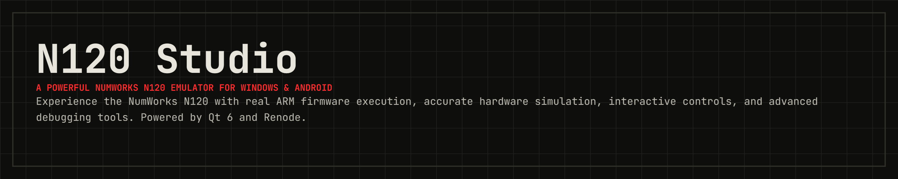
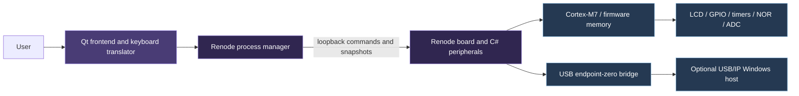

<!-- N120 Studio: GitHub README -->
<p align="center">
  
</p>

<p align="center">
  <strong>A hardware-level NumWorks N120 emulator for Windows, with an Android remote client.</strong><br>
  Powered by <strong>C++20</strong>, <strong>Qt 6</strong> and <strong>Renode</strong>.
</p>

<p align="center">
  
  
  
  
  
  
</p>

<p align="center">
  <a href="#installation">Download</a> ·
  <a href="#overview">Overview</a> ·
  <a href="#features">Features</a> ·
  <a href="#building-from-source">Build</a> ·
  <a href="#firmware-setup">Firmware</a> ·
  <a href="#android-client">Android</a> ·
  <a href="#project-architecture">Architecture</a> ·
  <a href="#testing">Testing</a>
</p>

---

## Overview

**N120 Studio** executes **user-supplied ARM firmware** on a modeled STM32H725VET6 / Cortex-M7 board and displays the pixels written by that firmware. It is designed to emulate hardware behavior rather than replace the calculator interface with a look-alike application.

| **Windows desktop** | **Android client** | **Firmware & release** |
| :--- | :--- | :--- |
| Native Qt Widgets application running a separate Renode engine. | Qt Quick app paired with an authenticated Windows host over TLS. | Bring your own compatible firmware; no official firmware is bundled. |
| **v1.0.0 installer available in Releases.** | **Remote rendering and controls; not a standalone emulator.** | **Bring your own firmware; the installer handles app dependencies.** |

> [!IMPORTANT]
> **Hardware compatibility:** N120 Studio models the N120 hardware for real firmware execution, but it is not a complete or cycle-accurate STM32H725 implementation. Some peripheral behavior and firmware configurations are not yet supported. This is an independent, unofficial project and is not affiliated with NumWorks.

## Android client

The installable Android application connects to an **authenticated Windows Renode host over TLS**, imports firmware using Android's native picker, controls the real matrix/peripherals and renders actual firmware-generated LCD frames.

> [!WARNING]
> **Android cannot execute the firmware on its own.** Standalone firmware execution is not implemented. A native Cortex-M7 feasibility probe runs on an Android AVD but stops at missing system hardware; it is not a bootable emulator. Physical-phone testing is still outstanding.

| Development APK | Target |
| :--- | :--- |
| `dist/android/n120-studio-arm64-v8a.apk` | Android 9+ ARM64 phones |
| `dist/android/n120-studio-x86_64.apk` | Android Virtual Device (AVD) |

Both files are **local development-signed outputs**, with no bundled firmware. See [Android installation and pairing](docs/android-usage.md), [Android build instructions](docs/android-building.md), [backend investigation](docs/android-backend.md) and the [feature/test matrix](docs/android-status.md).

---

## Features

| Area | Capabilities |
| :--- | :--- |
| 🧠 **CPU & board** | Renode Cortex-M7 execution, STM32H725VET6 memory map, interrupts, selected clock/timer models. |
| 🖥️ **LCD** | 320 × 240 RGB565 display, seven controller identities, initialization/gamma validation and backlight visualization. |
| ⌨️ **Input** | Clickable physical keys, simultaneous mouse/PC input, configurable key bindings, physical Shift/Alpha sequences and EXTI wake. |
| 🔋 **Power & LED** | RGB LED GPIO/PWM visualization; battery percentage, voltage/ADC, charging and VBUS controls. |
| 💾 **Flash** | 8 MiB external NOR flash, program/erase constraints, two 4 MiB slots and optional persistence. |
| ⏯️ **Execution** | Start, pause, resume, reset, in-process firmware reload and engine restart. |
| 🎛️ **Interface** | Standard, Compact and Developer layouts; light/dark appearance, bounded logs, Renode monitor and diagnostic export. |
| 🛠️ **Debugging** | Renode GDB server, reset-time BOOT0 selection and optional user-supplied system ROM. |
| 🔌 **USB (experimental)** | Loopback USB/IP endpoint-zero transport, optional Windows import and firmware DFU control requests. Full browser/site/update compatibility is **not guaranteed**. |

For exact coverage and limits, read the [architecture](docs/architecture.md), [USB documentation](docs/usb.md) and [debugging guide](docs/debugging.md).

## Requirements

**To run the desktop app:** 64-bit Windows (Windows 11 is the locally exercised platform) and compatible firmware that you supply. The **v1.0.0 installer** installs N120 Studio with its required application files, including the matching Qt runtime DLLs and plugins. It can also install **Renode 1.17.0** during setup when selected. If you skip Renode, install it separately and configure its executable before running the emulator. Other Windows versions have not been validated.

**To build from source:** CMake 3.24+, Ninja, a C++20 compiler and Qt 6.5+ with Widgets, Network and Test. Local validation uses Qt 6.11.1 with its matching MinGW GCC 13.1. Use a compiler matching your Qt kit. Python 3.13 is used for optional integration tests. No private source or firmware is required to compile or run desktop tests.

**Optional tools:** The installer offers **usbip-win2** for experimental Windows USB attachment and **Arm GDB** for source-level debugging. Choose these components during installation if needed; **GDB is optional and deselected by default**. Source debugging also requires a matching ELF file with symbols. USB/IP driver installation may require administrator approval.

## Installation

### Download v1.0.0

**The Windows installer is available in the [GitHub Releases](../../releases) section.** Download the **v1.0.0** setup executable and run it. You do not need to build the project or manually copy Qt DLLs and plugins when using the installer.

The installer includes the **N120 Studio application and its required runtime files**, and lets you select additional tools during setup:

| Component | Installation | Purpose |
| :--- | :--- | :--- |
| **N120 Studio + Qt runtime** | Included | Desktop application, required DLLs, Qt platform plugins and application resources. |
| **Renode 1.17.0** | Selectable in setup | Firmware execution engine; the installer can install it for you. Required for desktop emulation, but can be installed separately. |
| **usbip-win2** | Optional | Windows USB/IP device attachment and experimental USB support. May require driver installation and administrator privileges. |
| **Arm GDB** | Optional — **unchecked by default** | Debug ARM firmware through the built-in GDB server. |

1. Open [Releases](../../releases) and download the **v1.0.0 Windows installer**.
2. Run setup and choose whether to install Renode, USB/IP and Arm GDB.
3. Launch **N120 Studio**, select your own compatible firmware and start the emulator. If Renode was installed separately, select `renode.exe` in the app or configure `RENODE_PATH` / `PATH`.

> [!NOTE]
> The installer can set up the application and selected tools, but it **does not include calculator firmware**. Supply firmware that you are authorized to use. Android is a remote client and still needs the Windows host for firmware execution.

## Building from source

Clone your chosen checkout URL and enter it:

```powershell
git clone <repository-url> n120-emulator
cd n120-emulator
```

With Qt's matching compiler, Qt `bin`, Ninja and CMake on `PATH`, set your own Qt prefix:

```powershell
$env:CMAKE_PREFIX_PATH = 'C:/Qt/6.x.y/mingw_64'
cmake --preset debug
cmake --build --preset debug
ctest --preset debug
cmake --preset release
cmake --build --preset release
ctest --preset release
cmake --install build/release --prefix dist/n120
```

Executables are `build/debug/n120-studio.exe` and `build/release/n120-studio.exe`. `dist/n120/n120-studio.exe` is the staged executable with Qt deployment and Renode model files. This is the manual build and staging path; most Windows users can use the [v1.0.0 installer](../../releases) instead. Review [third-party notices](THIRD_PARTY_NOTICES.md) for the bundled dependencies.

In CLion, choose the matching Qt/compiler toolchain and the `debug` or `release` preset; set `CMAKE_PREFIX_PATH` in your local environment or ignored `CMakeUserPresets.json`. Legacy `windows-qt-mingw` and `studio-upgrade` preset names remain available with their previous output directories; configure dependency paths through your environment. Existing `build-upgrade` output is not required. See [build and deployment details](docs/building.md).

---

## Firmware setup

1. Launch the application and choose the Renode executable.
2. Select a raw internal BIN containing vectors, at most 512 KiB. It loads at `0x08000000`; its reset address must lie within the supplied image and its aligned stack must be in mapped RAM.
3. Optionally select an external image. Slot A starts at `0x90000000`; Slot B at `0x90400000`. Each slot spans 4 MiB. A full 8 MiB image must use Slot A/base. `external.bin`, `external.A.bin` and `external.B.bin` are filenames, not automatically detected container formats: choose the correct destination.
4. Choose a compatible LCD identity and start. Compatible internal/external versions are required; arbitrary ARM binaries are not guaranteed to boot.
5. For persistence, select **Saved flash (load & save)**. It overlays the input external image and is saved on stop/exit. **Save External Flash** writes a full 8 MiB image explicitly. Keep backups; the optional persistence destination is overwritten.

Obtain firmware through a source and workflow you are authorized to use. Official firmware, extracted calculator images and ST system ROM are not supplied or automatically downloaded. The public build has no firmware dependency.

## Usage

- **Start / Pause / Resume / Stop** control execution; **Reset MCU** resets peripherals while retaining external flash.
- **Reload Firmware** reloads the configured inputs within the engine and preserves the pause choice. **Restart Emulation Engine** recreates Renode.
- Stop before changing firmware, LCD identity or BOOT0 in hardware configuration.
- Mouse keys and arrows work directly. F1 is OK, F2 Power, F3 physical Shift, F4 physical Alpha, Enter EXE, Esc Back, Home Home and Backspace/Delete erase. Typed letters/operators become physical key sequences. Focus loss releases held inputs.
- View switches Standard, Compact and Developer layouts. Settings provides theme, text size, key mappings, refresh rate, logs, battery and emulation speed. Cancel restores appearance previews.
- **Settings → Appearance → Calculator style** selects Epsilon, Upsilon or Omega and remembers the choice. Android has the same selector under **Settings → Appearance & input**. Styles change the artwork while retaining the running calculator. The shared touch/mouse targets include larger arrow sectors and rounded, padded key areas.
- Power controls change battery ADC input and Unplugged/Charger/Computer cable state. They simulate endpoint values rather than battery chemistry.
- Developer inspectors show CPU, LCD, power, USB and flash state. Tools opens logs, the live Renode monitor and diagnostic export. Inspect exports before sharing: filenames and runtime diagnostics may identify local inputs.

## USB connectivity

To use Windows USB enumeration, select **usbip-win2** in the N120 Studio installer, or install a signed [usbip-win2 release](https://github.com/vadimgrn/usbip-win2/releases) manually. Driver installation may need elevated permissions. In Developer USB, select Computer cable mode, start USB/IP on **3240**, then Attach to Windows. Inspect Windows USB status to verify the actual imported port and PnP driver; reading the firmware descriptor alone does not prove OS enumeration.

Detach using the application when it owns the attachment. Reset/reload/cable changes end the data session; attach again afterward. Requests need the virtual CPU running. Endpoint zero is supported; bulk, interrupt and isochronous endpoint transports are not. Browser permission, firmware descriptors and WinUSB association affect WebUSB. WebDFU status support does not establish complete flashing or official-site compatibility. See [USB setup and limitations](docs/usb.md).

## Debugging

Enable the GDB server in Developer → CPU (default port 3333), then connect:

```text
arm-none-eabi-gdb path/to/matching-firmware.elf
(gdb) target remote localhost:3333
(gdb) info registers
(gdb) x/8wx 0x08000000
(gdb) break main
(gdb) continue
```

Raw BIN files have no source symbols. BOOT0 selects reset vectors in user-supplied H725 system memory at `0x1FF00000`; no functional ST ROM is bundled. Option-byte boot remapping is incomplete. See [debugging](docs/debugging.md).

---

## Project architecture



The GUI uses Qt events, timers, QProcess and asynchronous sockets. Renode runs in a separate process and compiles the C# models at launch. Firmware accesses modeled registers and writes LCD pixels. The bridge returns JSON state and RGB565 frames, rather than parsing console logs.

## Project structure

| Path | Purpose |
| --- | --- |
| `src/` | Existing Qt Widgets desktop frontend and Windows USB integration |
| `shared/` | Widgets-free backend interface, firmware validation, calculator coordinates and physical keyboard translation |
| `platforms/windows/` | Isolated desktop build configuration; existing frontend source remains in `src/` |
| `platforms/android/` | Dedicated Qt Quick mobile app, touch handling, SAF import/export and Android packaging |
| `backends/renode/` | Shared desktop/host Renode process manager |
| `backends/remote/` | Versioned TLS client and dedicated authenticated Windows session host |
| `backends/android-local/probe/` | Experimental native CPU feasibility probe, excluded from the APK |
| `renode/` | Platform address map and custom C# peripheral/USB models |
| `assets/` | Embedded calculator artwork and interface resources |
| `tests/` | Desktop controls and optional real-firmware Renode regression suites |
| `docs/` | Build, architecture, USB and debugging guidance |
| `.github/` | Windows build workflow and contribution templates |
| `scripts/` | Reproducible Android/TLS builds and private host setup |

---

## Testing

`ctest --preset debug` and `ctest --preset release` run desktop controls and startup without firmware or drivers, using Qt's offscreen platform.

Shared firmware/protocol contracts are tested in either desktop preset. Configure `-DN120_BUILD_MOBILE=ON` on Windows to also test touch ownership, private imports/settings and QML startup. `tests/remote_integration.py` validates the TLS service with user firmware; `tests/android_smoke.py` exercises an installed, paired Android application. The [Android status report](docs/android-status.md) records actual AVD, host and Windows regression evidence and remaining manual checks.

For private local integration testing, set paths to your own files:

```powershell
$env:RENODE_PATH = 'C:/path/to/Renode/renode.exe'
$env:N120_INTERNAL = 'C:/firmware/internal.bin'
$env:N120_EXTERNAL = 'C:/firmware/external.bin'
python tests/integration.py
python tests/upgrade_hardware.py
python tests/lifecycle.py
python tests/usb_lifecycle.py
python tests/usb_protocol.py
python tests/debug_boot.py
./build/release/n120-studio.exe --firmware-smoke
```

GUI smoke captures go to `test-output/` beside the executable, or `N120_TEST_OUTPUT`. Integration scripts also accept `--renode`, `--internal` and `--external`. They write ignored local evidence under `docs/` and `build/test-sessions/`; run sequentially. `--ui-smoke` needs no firmware. `--firmware-smoke` exercises layouts/settings and captures images; `--usb-smoke` additionally operates the Windows importing client and requires a prepared driver environment. Run driver/browser tests manually, never on a machine with unrelated USB work in progress. A synthetic BOOT0 fixture tests vector selection only, not real ST ROM behavior.

The Windows CI builds and runs noninteractive desktop tests without private inputs. Renode/firmware, driver, browser and clean-machine checks are separate local procedures.

## Known limitations

The model is not exhaustive silicon emulation: DMA/MDMA, cache timing/coherence, internal flash programming/protection/option bytes, all RCC/EXTI fields, all LCD orientations and every USB endpoint are incomplete. Analog settling is idealized; NOR busy completion is based on polling rather than physical timing. PWM visualizes programmed duty. Firmware compatibility outside the tested paths requires verification. Slot B loading is implemented; a separately bootable Slot B firmware is not established by bounds checks. Local monitor/control ports are trusted debugging interfaces, not authenticated services. Some configurations may require manual setup or additional driver permissions.

## Troubleshooting

| Symptom | Checks |
| --- | --- |
| Renode not found | Select `renode.exe`, set `RENODE_PATH` or update `PATH`; inspect engine logs |
| Missing Qt DLL/platform plugin | Run CMake install; keep `platforms/qwindows.dll` and matching runtime DLLs together |
| Firmware rejected | Check raw BIN size, vectors, permissions and internal/external compatibility |
| Blank LCD | Allow boot time; inspect fault registers, LCD identity, gamma, backlight and firmware logs |
| USB not detected | Use Computer mode, running CPU, server port 3240, signed importing driver and actual PnP status |
| Browser cannot open device | Check browser permission, WinUSB binding, firmware descriptors and other clients holding the device |
| GDB connection refused | Enable server, check port conflict/firewall and ARM-capable debugger |
| Slow emulation | Measure actual virtual/wall speed; reduce diagnostics rate and logging; use Release; avoid halting during USB |

---

## Contributing

See [CONTRIBUTING.md](CONTRIBUTING.md). Preserve real firmware execution and hardware semantics. Include reproducible evidence for behavior changes and never submit firmware or personal logs. Security reporting guidance is in [SECURITY.md](SECURITY.md).

## License

N120 Studio is released under the **[MIT License](LICENSE.md)**. You may use, copy, modify, distribute, sublicense and sell the project, including for commercial purposes, as long as you preserve the copyright notice and license text. The software is provided **as is**, without warranty.

Third-party components such as Qt, Renode and usbip-win2 remain subject to their own licenses; see [third-party notices](THIRD_PARTY_NOTICES.md).

## Credits and acknowledgments

Development of this project was substantially assisted by OpenAI Codex, including implementation, debugging, refactoring, and testing. Thanks to Antmicro and Renode contributors for the execution framework, Qt contributors for the desktop toolkit, and usbip-win2 contributors for optional Windows USB importing. NumWorks and STMicroelectronics names identify the hardware and compatible firmware ecosystems; no affiliation is implied.

## Disclaimer

N120 Studio is an independent, unofficial project and is not affiliated with, sponsored by or endorsed by NumWorks. Its hardware emulation is not guaranteed to support every firmware or peripheral feature.
