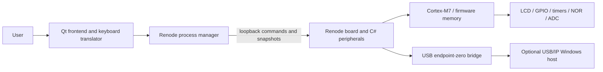

# NumWorks N120 Emulator

A Windows desktop hardware emulator for the NumWorks N120 calculator, built with C++20, Qt 6 and Renode. N120 Studio executes user-supplied ARM firmware on a Cortex-M7 board model and displays pixels written by that firmware.

This is an unofficial project, not affiliated with, sponsored by, or endorsed by NumWorks. The model targets observed N120 firmware behavior; it is not a complete or cycle-accurate STM32H725 implementation.

**Release status:** engineering validation is in progress. Application licensing, hardware-model provenance and calculator artwork rights must be resolved before public distribution. No official firmware is included.

## Features

- Renode Cortex-M7 execution, STM32H725VET6 memory map, interrupts and selected clock/timer models.
- 320 × 240 RGB565 LCD, seven controller identities, initialization and gamma validation, backlight visualization.
- Clickable physical keys, simultaneous mouse/PC input, configurable keyboard bindings, physical Shift/Alpha sequences and EXTI wake.
- RGB LED GPIO/PWM visualization; battery percentage, voltage/ADC and charging/VBUS controls.
- 8 MiB external NOR flash, program/erase constraints, two slots and optional persistence.
- Start, pause, resume, reset, in-process firmware reload and engine restart.
- Standard, Compact and Developer layouts; light/dark appearance, bounded logs, monitor console and diagnostic export.
- Renode GDB server and reset-time BOOT0 selection with a user-supplied system ROM.
- Experimental loopback USB/IP endpoint-zero transport, optional Windows import and firmware DFU control requests. Full browser/site/update compatibility is not guaranteed.

See [hardware coverage and architecture](docs/architecture.md), [USB](docs/usb.md) and [debugging](docs/debugging.md) for limits.

## Screenshots

The firmware smoke mode captures Standard, Compact, Developer and settings views locally. Public screenshots are withheld until the calculator artwork and displayed firmware redistribution rights are cleared. To generate your own captures, see [testing](#testing); the File menu also saves the LCD or full window.

## Requirements

**Running:** 64-bit Windows (Windows 11 is the locally exercised platform), Qt runtime DLLs/plugins beside the executable, separately installed Renode 1.17.0, and compatible firmware you are entitled to use. Other Windows versions are not validated. Renode's distribution supplies its own runtime dependencies.

**Development:** CMake 3.24+, Ninja, a C++20 compiler and Qt 6.5+ with Widgets, Network and Test. Local validation uses Qt 6.11.1 with its matching MinGW GCC 13.1. Use a compiler matching your Qt kit. Python 3.13 is used for optional integration tests. No private source or firmware is required to compile or run desktop tests.

**Optional:** signed usbip-win2 importing client/controller for Windows USB, and an ARM-capable GDB plus matching ELF symbols for source debugging.

## Installation

No public binary release is provided yet. Build from source, stage the application as below, and keep the staged DLLs and plugins together. Install Renode separately from [Renode's official site](https://renode.io/). Select its executable in the configuration dialog, set `RENODE_PATH`, or put it on `PATH`.

## Building from source

Clone your chosen checkout URL and enter it:

```powershell
git clone <repository-url> n120-emulator
cd n120-emulator
```

With Qt's matching compiler, Qt `bin`, Ninja and CMake on `PATH`, set your own Qt prefix:

```powershell
$env:CMAKE_PREFIX_PATH = 'C:/Qt/6.x.y/mingw_64'
cmake --preset debug
cmake --build --preset debug
ctest --preset debug
cmake --preset release
cmake --build --preset release
ctest --preset release
cmake --install build/release --prefix dist/n120
```

Executables are `build/debug/n120-studio.exe` and `build/release/n120-studio.exe`. `dist/n120/n120-studio.exe` is the staged executable with Qt deployment and Renode model files. This is a local engineering package, not a cleared redistributable release. Review [third-party notices](THIRD_PARTY_NOTICES.md) before distributing any binaries.

In CLion, choose the matching Qt/compiler toolchain and the `debug` or `release` preset; set `CMAKE_PREFIX_PATH` in your local environment or ignored `CMakeUserPresets.json`. Legacy `windows-qt-mingw` and `studio-upgrade` preset names remain available with their previous output directories; configure dependency paths through your environment. Existing `build-upgrade` output is not required. See [build and deployment details](docs/building.md).

## Firmware setup

1. Launch the application and choose the Renode executable.
2. Select a raw internal BIN containing vectors, at most 512 KiB. It loads at `0x08000000`; its reset address must lie within the supplied image and its aligned stack must be in mapped RAM.
3. Optionally select an external image. Slot A starts at `0x90000000`; Slot B at `0x90400000`. Each slot spans 4 MiB. A full 8 MiB image must use Slot A/base. `external.bin`, `external.A.bin` and `external.B.bin` are filenames, not automatically detected container formats: choose the correct destination.
4. Choose a compatible LCD identity and start. Compatible internal/external versions are required; arbitrary ARM binaries are not guaranteed to boot.
5. For persistence, select **Saved flash (load & save)**. It overlays the input external image and is saved on stop/exit. **Save External Flash** writes a full 8 MiB image explicitly. Keep backups; the optional persistence destination is overwritten.

Obtain firmware through a source and workflow you are authorized to use. Official firmware, extracted calculator images and ST system ROM are not supplied or automatically downloaded. The public build has no firmware dependency.

## Usage

- **Start / Pause / Resume / Stop** control execution; **Reset MCU** resets peripherals while retaining external flash.
- **Reload Firmware** reloads the configured inputs within the engine and preserves the pause choice. **Restart Emulation Engine** recreates Renode.
- Stop before changing firmware, LCD identity or BOOT0 in hardware configuration.
- Mouse keys and arrows work directly. F1 is OK, F2 Power, F3 physical Shift, F4 physical Alpha, Enter EXE, Esc Back, Home Home and Backspace/Delete erase. Typed letters/operators become physical key sequences. Focus loss releases held inputs.
- View switches Standard, Compact and Developer layouts. Settings provides theme, text size, key mappings, refresh rate, logs, battery and emulation speed. Cancel restores appearance previews.
- Power controls change battery ADC input and Unplugged/Charger/Computer cable state. They simulate endpoint values rather than battery chemistry.
- Developer inspectors show CPU, LCD, power, USB and flash state. Tools opens logs, the live Renode monitor and diagnostic export. Inspect exports before sharing: filenames and runtime diagnostics may identify local inputs.

## USB connectivity

Install a signed [usbip-win2 release](https://github.com/vadimgrn/usbip-win2/releases) separately if you need Windows enumeration. The application does not install drivers. In Developer USB, select Computer cable mode, start USB/IP on **3240**, then Attach to Windows. Inspect Windows USB status to verify the actual imported port and PnP driver; reading the firmware descriptor alone does not prove OS enumeration.

Detach using the application when it owns the attachment. Reset/reload/cable changes end the data session; attach again afterward. Requests need the virtual CPU running. Endpoint zero is supported; bulk, interrupt and isochronous endpoint transports are not. Browser permission, firmware descriptors and WinUSB association affect WebUSB. WebDFU status support does not establish complete flashing or official-site compatibility. See [USB setup and limitations](docs/usb.md).

## Debugging

Enable the GDB server in Developer → CPU (default port 3333), then connect:

```text
arm-none-eabi-gdb path/to/matching-firmware.elf
(gdb) target remote localhost:3333
(gdb) info registers
(gdb) x/8wx 0x08000000
(gdb) break main
(gdb) continue
```

Raw BIN files have no source symbols. BOOT0 selects reset vectors in user-supplied H725 system memory at `0x1FF00000`; no functional ST ROM is bundled. Option-byte boot remapping is incomplete. See [debugging](docs/debugging.md).

## Project architecture



The GUI uses Qt events, timers, QProcess and asynchronous sockets. Renode runs in a separate process and compiles the C# models at launch. Firmware accesses modeled registers and writes LCD pixels. The bridge returns JSON state and RGB565 frames, rather than parsing console logs.

## Project structure

| Path | Purpose |
| --- | --- |
| `src/` | Qt UI, keyboard translation, lifecycle and host USB integration |
| `renode/` | Platform address map and custom C# peripheral/USB models |
| `assets/` | Embedded calculator skin (rights pending) |
| `tests/` | Desktop controls and optional real-firmware Renode regression suites |
| `docs/` | Build, architecture, USB and debugging guidance |
| `.github/` | Windows build workflow and contribution templates |

## Testing

`ctest --preset debug` and `ctest --preset release` run desktop controls and startup without firmware or drivers, using Qt's offscreen platform.

For private local integration testing, set paths to your own files:

```powershell
$env:RENODE_PATH = 'C:/path/to/Renode/renode.exe'
$env:N120_INTERNAL = 'C:/firmware/internal.bin'
$env:N120_EXTERNAL = 'C:/firmware/external.bin'
python tests/integration.py
python tests/upgrade_hardware.py
python tests/lifecycle.py
python tests/usb_lifecycle.py
python tests/usb_protocol.py
python tests/debug_boot.py
./build/release/n120-studio.exe --firmware-smoke
```

GUI smoke captures go to `test-output/` beside the executable, or `N120_TEST_OUTPUT`. Integration scripts also accept `--renode`, `--internal` and `--external`. They write ignored local evidence under `docs/` and `build/test-sessions/`; run sequentially. `--ui-smoke` needs no firmware. `--firmware-smoke` exercises layouts/settings and captures images; `--usb-smoke` additionally operates the Windows importing client and requires a prepared driver environment. Run driver/browser tests manually, never on a machine with unrelated USB work in progress. A synthetic BOOT0 fixture tests vector selection only, not real ST ROM behavior.

The Windows CI builds and runs noninteractive desktop tests without private inputs. Renode/firmware, driver, browser and clean-machine checks are separate local procedures.

## Known limitations

The model is not exhaustive silicon emulation: DMA/MDMA, cache timing/coherence, internal flash programming/protection/option bytes, all RCC/EXTI fields, all LCD orientations and every USB endpoint are incomplete. Analog settling is idealized; NOR busy completion is based on polling rather than physical timing. PWM visualizes programmed duty. Firmware compatibility outside the tested paths requires verification. Slot B loading is implemented; a separately bootable Slot B firmware is not established by bounds checks. Local monitor/control ports are trusted debugging interfaces, not authenticated services. No clean-machine installation claim is made.

## Troubleshooting

| Symptom | Checks |
| --- | --- |
| Renode not found | Select `renode.exe`, set `RENODE_PATH` or update `PATH`; inspect engine logs |
| Missing Qt DLL/platform plugin | Run CMake install; keep `platforms/qwindows.dll` and matching runtime DLLs together |
| Firmware rejected | Check raw BIN size, vectors, permissions and internal/external compatibility |
| Blank LCD | Allow boot time; inspect fault registers, LCD identity, gamma, backlight and firmware logs |
| USB not detected | Use Computer mode, running CPU, server port 3240, signed importing driver and actual PnP status |
| Browser cannot open device | Check browser permission, WinUSB binding, firmware descriptors and other clients holding the device |
| GDB connection refused | Enable server, check port conflict/firewall and ARM-capable debugger |
| Slow emulation | Measure actual virtual/wall speed; reduce diagnostics rate and logging; use Release; avoid halting during USB |

## Contributing

See [CONTRIBUTING.md](CONTRIBUTING.md). Preserve real firmware execution and hardware semantics. Include reproducible evidence for behavior changes and never submit firmware, personal logs or unlicensed assets. Security reporting guidance is in [SECURITY.md](SECURITY.md).

## License

A main project license has not yet been authorized. Public release is blocked pending ownership/provenance clearance and license selection. Dependency licenses do not license the application itself. See [THIRD_PARTY_NOTICES.md](THIRD_PARTY_NOTICES.md) for obligations and unresolved asset rights.

## Credits and acknowledgments

Development of this project was substantially assisted by OpenAI Codex, including implementation, debugging, refactoring, and testing. Thanks to Antmicro and Renode contributors for the execution framework, Qt contributors for the desktop toolkit, and usbip-win2 contributors for optional Windows USB importing. NumWorks and STMicroelectronics names identify the hardware and compatible firmware ecosystems; no affiliation is implied.

## Disclaimer

This unofficial project is not affiliated with, sponsored by, or endorsed by NumWorks. Hardware and firmware names and trademarks belong to their respective owners. Compatibility and emulation results must be evaluated against the documented model limitations.
