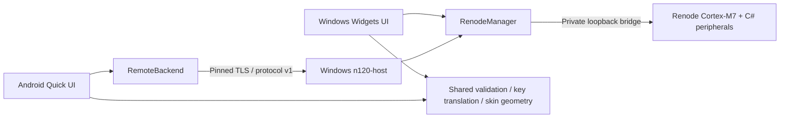

# Architecture and hardware coverage

## Cross-platform boundaries

The root CMake project selects the existing Widgets desktop application through `platforms/windows/`, or the independent Qt Quick mobile target through `platforms/android/`. Windows output names and presets are preserved. The Android build never discovers Widgets, Windows USB drivers, desktop Renode or the Android-unavailable QProcess APIs used by the host. Desktop builds do not require an Android SDK/NDK.

`shared/core` is a pure C++20 library for H725 firmware/reset-vector validation, flash image bounds and LCD identities. `shared/input` uses Qt Core/Gui (not Widgets) for the existing physical key translator and exact 1160 × 2221 artwork coordinates. `shared/interfaces/EmulatorBackend.h` defines asynchronous snapshots/state/log/error delivery and lifecycle/matrix/power operations. `RenodeManager` implements it for both Windows executables; `RemoteBackend` implements it for the mobile frontend. Platform-specific configuration paths and SAF URI handling stay in the mobile controller. The established Windows settings namespace remains unchanged; mobile uses a separate namespace/private storage.

The desktop frontend source intentionally remains in `src/`, avoiding unnecessary file moves. `backends/renode/` now owns process/socket management. The board models stay in `renode/` because their C# register/timer/memory behavior depends on Renode interfaces. They are shared by desktop and remote host, not falsely classified as portable C++.

The host is a dedicated calculator session, not an unauthenticated proxy to the desktop monitor. Android local execution is incomplete; see [research and blockers](android-backend.md), [usage](android-usage.md), [builds](android-building.md) and [test/feature status](android-status.md).

## Remote protocol v1

TLS 1.2 or later carries a 32-bit big-endian byte length and UTF-8 JSON object. Every object has `v: 1` and a `type`. Packet size is bounded at 12 MiB, enough for an 8 MiB base64 flash image. Queued output is bounded, and slow clients skip intermediate snapshots. Parsing accepts fragmentation/coalescing and rejects invalid lengths, JSON or versions. The Android client pins the full certificate SHA-256 before sending the random pairing token. The server admits one controller, authenticates before operations and expires missing heartbeats after 10 seconds. A ping is sent every 2 seconds. TLS data progress extends the timeout for larger transfers.

Client messages: `auth`, `ping`, `start` (LCD identity), `stop`, `reload`, `restart`, `import` (fixed internal/slotA/slotB/flash destinations), `exportFlash`, and `control` (allowlisted matrix, sequence, pause/resume/reset, battery, cable, speed). No supplied host filesystem paths, process arguments, shell commands, monitor or GDB commands are accepted. Server messages: `welcome`, `pong`, `state`, `snapshot`, `log`, `error`, `imported`, `flash`. Protocol integers/fields are validated by the receiving implementation; unknown operations are rejected.

Snapshots retain the existing hardware schema: PC/SP, instruction count, virtual time, execution flags, battery/ADC, GPIO matrix, LCD/gamma/backlight, RGB/PWM, flash counters and USB state. Changed LCD frames are base64 little-endian RGB565; identical frames are omitted while state continues at the backend's bounded 100 ms refresh. A new connection always receives a full frame. Thus paused/unchanged screens do not repeatedly transfer 153,600 framebuffer bytes. This is a versioned JSON protocol rather than a compressed binary-delta transport; further bandwidth optimization remains possible.

Disconnect releases all 54 matrix switches, pauses execution and atomically checkpoints flash. The same applies after lost heartbeat. Flash is also checkpointed every 15 seconds and on stop/reload. The remote application owns its own input copies and atomic local backups. It uses Qt's Android content-URI file engine only while the native picker permission is valid, then copies into app-private storage. Settings and credentials are app-private; Android cloud backup is disabled.

Android uses one independent LCD item/texture, an immutable calculator image, and per-key feedback overlays. Firmware snapshots update LCD pixels, LED and diagnostics without regenerating the artwork. Touch IDs own switches and shared switches are reference-counted across fingers/physical bindings. UI interruption/cancellation releases ownership. Rotation is handled by the Qt Android activity without restarting the emulation session. No foreground service or phone background CPU engine runs.

## Existing Renode hardware coverage

The Qt process owns UI state, persisted preferences, keyboard translation, bounded logs and Renode process/socket management. The Renode process loads `n120.repl`, compiles `N120.cs` and `UsbHost.cs`, and executes the supplied binaries. Newline-framed loopback commands carry controls; JSON snapshots include state and a base64 RGB565 framebuffer. The default refresh interval is 100 ms. These local interfaces are trusted debugger interfaces.

| Region | Mapping |
| --- | --- |
| Internal flash | 0x08000000, 512 KiB |
| System memory | 0x1FF00000, 128 KiB; requires user ROM for boot |
| ITCM / DTCM | 0x00000000 / 0x20000000 |
| AXI SRAM | 0x24000000, 320 KiB |
| SRAM1/2 / SRAM4 | 0x30000000 / 0x30004000 / 0x38000000 |
| External NOR | 0x90000000, 8 MiB; second slot 0x90400000 |
| LCD command / data | 0x60000000 / 0x60020000 |
| OctoSPI registers | 0x52005000 |

Renode supplies Cortex-M7, NVIC, compatible RCC/EXTI/timers, CRC and RNG. Local extensions adapt SysTick clock selection, timer clock propagation, GPIO switch matrix/EXTI, LCD initialization/pixels, NOR operations, ADC endpoint values and STM32 USB behavior. The GUI does not generate firmware screens. RGB gates are PB4/PB5/PC8; timer modes determine visualized PWM duty. Keyboard rows are nine GPIO outputs and columns six inputs, including closed-switch propagation and old/revised wiring.

NOR requires WEL, applies bitwise AND programming with page wrap, supports selected erase sizes and retains data across MCU reset. Persistence explicitly overwrites a selected output file. Internal-flash controller algorithms, DMA, cache coherence, full clock mux coverage and exhaustive display commands are incomplete. Analog/power settling is idealized; NOR busy status advances through status polls. These are model limitations, not evidence of complete physical-device equivalence.

Keep CPU time synchronization outside peripheral locks where Renode requires it. UI sockets and QProcess use Qt events. USB host work uses bounded queues, cancellation and serialized EP0 transactions; reset/cable changes terminate data sessions. Avoid GUI waits in normal operation; destructor waits are bounded. Run integration suites sequentially because evidence paths are shared.
